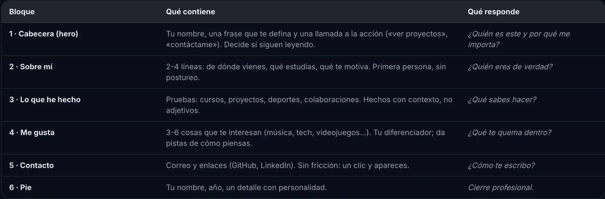
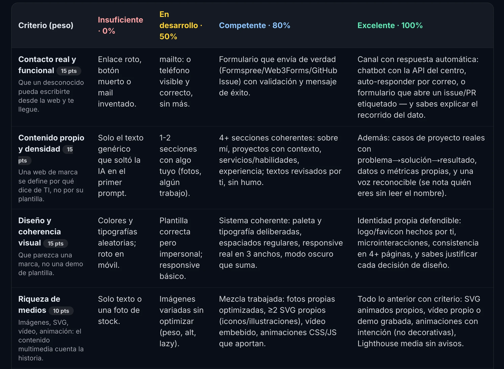
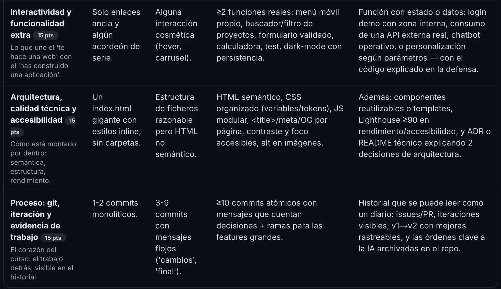

# Brief del rediseño v3

Punto de partida para rehacer la web desde cero en una conversación nueva con la IA.
Issue: #21. Versiones anteriores: etiquetas `v1` (Cyberpunk 2077) y `v2` (espacial,
inspirada en Super Mario Galaxy).

## 1. Por qué una v3

Quiero rehacer la web **totalmente de cero** con una identidad nueva. La v2 funciona y
puntúa bien en Lighthouse; el motivo es de diseño, no técnico. La IA no debe partir de
la estética de la v2 (planetas, Unbounded, paleta índigo) salvo que yo lo pida.

## 2. Rúbrica y pauta

- Pauta de estructura: 
- Rúbrica:  

Resumen de lo que pide el nivel Excelente de cada criterio:

| Criterio | Peso | Excelente |
|---|---|---|
| Contacto real y funcional | 15 | Canal con respuesta automática (chatbot o auto-responder) y saber explicar el recorrido del dato |
| Contenido propio y densidad | 15 | Casos problema → solución → resultado, métricas propias, voz reconocible |
| Diseño y coherencia visual | 15 | Identidad propia, logo/favicon propios, microinteracciones, coherente en 4+ páginas, cada decisión justificada |
| Riqueza de medios | 10 | SVG animados propios, vídeo o demo grabada, animaciones con intención, Lighthouse sin avisos |
| Interactividad | 15 | Función con estado o datos: API externa real, chatbot operativo, personalización… explicado en la defensa |
| Arquitectura y accesibilidad | 15 | Componentes reutilizables, Lighthouse ≥ 90, README/ADR con 2 decisiones de arquitectura |
| Proceso: git | 15 | Historial legible como diario: issues/PR, iteraciones visibles, v1 → v2 → v3, órdenes a la IA archivadas en el repo |

Publicación: **GitHub Pages** (`https://marcalvear.github.io/mi-web/`). Se pueden usar
servicios de terceros; cuanta más diversidad, mejor.

## 3. Mis datos

- **Frase de la cabecera:** «Aprendo inteligencia artificial para ayudar a startups e
  infoproductores a dar vida a sus proyectos.» CTA: «Ponte en contacto conmigo».
- **Origen y estudios:** València (España). 1º de DAM en el IES Dr. Lluís Simarro, curso 2026-2027.
- **Motivación:** explorar hasta dónde llega la IA para delegarle lo automatizable y que las
  personas nos centremos en crear y ser originales, algo que la IA no puede hacer. Quiero
  contribuir a un mundo en el que nos dediquemos a lo que nos gusta y la IA haga el trabajo
  aburrido. Mi interés empezó al ver que la IA hace en mucho menos tiempo, y a menudo mejor,
  muchas tareas de los entornos profesionales.
- **Lo que he hecho:** Sonrisa Imperial (único proyecto por ahora; iré añadiendo más),
  certificado C1 Advanced de Cambridge English, pádel como aficionado desde hace 2 años.
- **Me gusta:** videojuegos (Zelda: Breath of the Wild, Bloodborne, Pokémon), anime y manga
  (Naruto Shippuden, JoJo's Bizarre Adventure) y biohacking (TheraFace Mask Glo, JetBoots
  Prime, Eight Sleep Pod, Oura Ring).
- **Contacto:** GitHub `github.com/marcalvear`, LinkedIn `linkedin.com/in/marccalatayud`.
- **Foto:** `assets/img/marc/` (ya recortada y sin metadatos).

## 4. Qué se puede reutilizar de la v2

Funciona y no depende de la estética; se puede aprovechar o rehacer:

| Pieza | Dónde | Estado |
|---|---|---|
| Formulario FormSubmit con respuesta automática | `index.html`, `assets/js/contacto.js`, `gracias.html` | **Funciona en producción** (probado el 19/10/2026, ver #5). Alias en el `action`, no el email |
| Chatbot: Worker + widget | `worker/chatbot`, `assets/js/components/chat-bot.js` | Código y 6 pruebas OK. **Sin desplegar** |
| Módulos de APIs | `assets/js/me-gusta/`, `assets/js/lib/api.js` | Funcionan: PokéAPI + 3D, Hyrule Compendium, Animechan |
| Caso de estudio Sonrisa Imperial | `proyectos/sonrisa-imperial/` | Métricas reales y vídeo de demo |
| Script del vídeo | `docs/video/` | Regenera la demo con puppeteer-core |
| ADR | `docs/adr/` | 0002 y 0003 siguen valiendo; 0001 depende de la arquitectura de la v3 |

## 5. Lecciones de la v2

- La foto original del móvil llevaba **GPS**: quitar siempre los metadatos. `recursos/` está en `.gitignore`.
- Hyrule Compendium se mudó a `api.hyrule-compendium.com` (Heroku ya no existe).
- Animechan: 100 peticiones al día por IP y solo tiene «Naruto» (incluye Shippuden). No pedir frases al cargar.
- GitHub Pages publica en `/mi-web/`: rutas relativas y `<base>` dinámica en la 404.
- FormSubmit solo envía la respuesta automática con envío normal (sin `fetch`) y captcha activado.
- Las fuentes de Google bloqueaban el pintado; servirlas desde la web subió el rendimiento de 91 a 98.
- `prefers-reduced-motion`, contraste AA y nombre accesible en enlaces con solo icono.
- Trabajar con issue → rama → commits pequeños → PR. Los PR los fusiono yo.

## 6. Pendientes

- [ ] Desplegar el chatbot: `npx wrangler login` y `npx wrangler deploy` en `worker/chatbot`, y poner la URL en `CHATBOT_URL`.
- [ ] Música propia creada con IA: etérea, espacial y relajante (#8).
- [ ] Revisar yo los textos escritos con mi voz.
- [x] Activar FormSubmit y ocultar el email con el alias.

## 7. Ideas de diseño para la v3

*(Las escribo yo.)*
